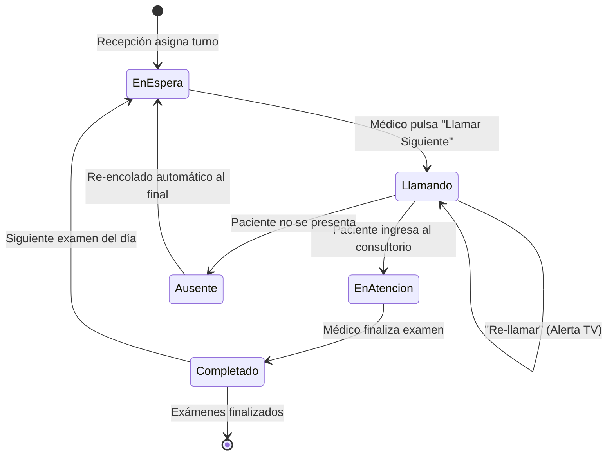

# Manual de Usuario: Digiturno IPS Consalud Laboral

**Versión:** 2.0  
**Fecha:** Octubre 2026  
**Sistema:** Digiturno — Gestión Integral de Turnos y Colas Médicas  
**Entorno:** Backend Laravel 11 + Frontend React 19 + Reverb WebSockets

---

## Índice
1. [Introducción y Objetivos](#1-introducción-y-objetivos)
2. [Acceso al Sistema y Seguridad](#2-acceso-al-sistema-y-seguridad)
3. [Módulo de Recepción](#3-módulo-de-recepción)
4. [Módulo de Consultorios y Atención Médica](#4-módulo-de-consultorios-y-atención-médica)
5. [Módulo de Pantalla de Turnos (Display TV)](#5-módulo-de-pantalla-de-turnos-display-tv)
6. [Módulo de Administración](#6-módulo-de-administración)
7. [Módulo de Tablero de Control y Métricas (Dashboard)](#7-módulo-de-tablero-de-control-y-métricas-dashboard)
8. [Ciclo de Vida y Reglas de Negocio de los Turnos](#8-ciclo-de-vida-y-reglas-de-negocio-de-los-turnos)
9. [Preguntas Frecuentes y Solución de Problemas](#9-preguntas-frecuentes-y-solución-de-problemas)

---

## 1. Introducción y Objetivos

**Digiturno** es la solución tecnológica diseñada para optimizar el flujo de pacientes en la IPS Consalud Laboral. El sistema coordina la recepción de pacientes, la asignación inteligente de turnos para exámenes ocupacionales, la llamada audiovisual en salas de espera y la atención en cada consultorio.

### Objetivos Clave:
* **Eliminar filas físicas y aglomeraciones** en salas de espera.
* **Integración en tiempo real con Consalud:** Consulta automática de órdenes de ingreso y exámenes pendientes por cédula.
* **Llamado audiovisual sincronizado:** Anuncio en pantallas de TV con voz artificial (TTS) y campanilla.
* **Trazabilidad y métricas:** Tiempos exactos de espera y duración de atención por servicio.

---

## 2. Acceso al Sistema y Seguridad

### 2.1. Inicio de Sesión (`/login`)
El personal de la IPS debe autenticarse para ingresar a las funciones operativas:

1. Ingrese a la dirección del sistema en el navegador (ejemplo: `http://localhost:5173/`). Si no tiene sesión activa, será redirigido a `/login`.
2. En el formulario, digite sus credenciales autorizadas de **Consalud Laboral**:
   * **Usuario o Correo Electrónico:** Su usuario institucional (ej. `mrecepcion` o `correo@consaludlaboral.com.co`).
   * **Contraseña:** Su clave de acceso.
3. Presione el botón **"Entrar al Sistema"**.
4. Al ingresar correctamente, el sistema mostrará un saludo de bienvenida y lo dirigirá al **Panel de Recepción**.

### 2.2. Medidas de Seguridad Activas
* **Protección Anti-XSS:** El token de autenticación se gestiona en cookies seguras inaccesibles por scripts maliciosos.
* **Protección Anti-Fuerza Bruta:** El sistema bloquea temporalmente los intentos tras 5 accesos fallidos consecutivos en un minuto.
* **Cierre Automático por Inactividad:** Si el equipo permanece sin movimiento de ratón o teclado durante **15 minutos**, la sesión se cerrará automáticamente protegiendo la información confidencial de los pacientes.
* **Cierre de Sesión Manual:** En la parte superior derecha de la pantalla, pulse el botón **"Salir"** en cualquier momento para terminar su turno.

---

## 3. Módulo de Recepción

**Ruta:** `/recepcion`  
**Destinatarios:** Personal de Admisiones y Recepción.

Este panel es el centro de operaciones donde se registra la llegada del paciente y se canalizan sus turnos.

### 3.1. Búsqueda de Pacientes por Cédula
1. Ubique el panel lateral izquierdo titulado **"Buscar Paciente"**.
2. Digite el número de documento de identidad (cédula) del paciente.
3. Presione la tecla **Enter** o haga clic en el botón con la lupa.
4. El sistema consultará en línea la base de datos de **Consalud**:
   * Si el paciente tiene una orden de ingreso activa para el día, aparecerá su tarjeta con nombre completo, documento y teléfono.
   * Si no se encuentra ingreso del día, el sistema le alertará en pantalla.

### 3.2. Asignación de Turnos para Exámenes
1. Al hacer clic sobre el paciente encontrado, se abre el modal con el **Detalle del Ingreso**.
2. Podrá visualizar:
   * Empresa/Cliente remitente.
   * Tipo de evaluación (Ingreso, Periódico, Egreso, etc.).
   * Lista de exámenes requeridos (Audiometría, Visiometría, Laboratorio, Espiometría, Médico General, etc.).
3. Seleccione los exámenes que el paciente realizará en la sede y presione **"Asignar Turnos"**.
4. El sistema generará los códigos de turno (ejemplo: `MED-001`, `LAB-002`) y los encolará en las respectivas salas.

### 3.3. Monitoreo de Colas y Acciones Rápidas
* **Lista de Espera en Vivo:** Muestra la fila de pacientes organizados por orden de llegada y prioridad.
* **Llamado Manual:** En caso de requerir re-llamar a un paciente específico, digite su número de turno y presione *"Llamar"*.
* **Acceso a Pantallas:** El botón *"Pantallas"* abre la visualización pública para verificar el estado de la sala.

---

## 4. Módulo de Consultorios y Atención Médica

**Ruta:** `/consultorio/:areaId`  
**Destinatarios:** Médicos especialistas, bacteriólogos, audiólogos, optómetras y enfermeros.

Cada profesional abre su consultorio específico (ejemplo: Consultorio Médico 1, Audiometría, Toma de Muestras).

### 4.1. Flujo de Atención del Especialista
1. **Llamar al Siguiente Paciente:**
   * El especialista pulsa el botón principal **"Llamar Siguiente"**.
   * El sistema selecciona automáticamente al paciente con mayor tiempo de espera en esa área.
   * Al hacer clic, la **Pantalla de la Sala (Display)** emite un timbre sonoro y la voz virtual anuncia: *"Turno MED-005, pasar a Consultorio 1"*.
2. **Re-llamado:**
   * Si el paciente tarda en ingresar, pulse **"Re-llamar"** para volver a emitir el sonido y la alerta en pantalla.
3. **Completar Atención:**
   * Una vez finalizado el examen o consulta, pulse **"Completar"**.
   * El turno queda finalizado con la hora exacta registrada para fines de auditoría.
   * Si el paciente tiene más exámenes pendientes en otras áreas, el sistema lo encola automáticamente en su siguiente estación.
4. **Marcar como Ausente:**
   * Si el paciente no se presenta tras repetidos llamados, pulse **"Ausente"**.
   * El paciente pasa al final de la fila de espera con penalización de orden para dar paso a quienes sí están presentes.

---

## 5. Módulo de Pantalla de Turnos (Display TV)

**Ruta:** `/display` (o `/display/:areaId` para salas específicas)  
**Destinatarios:** Televisores y pantallas de las salas de espera de pacientes.  
**Acceso:** Público (no exige inicio de sesión para permitir el arranque automático en Smart TVs o Mini PCs).

### 5.1. Elementos Visuales de la Pantalla
* **Zona Principal (Llamado Activo):**
  * Muestra en tamaño gigante el número de turno llamado (ej. `AUD-003`).
  * Destaca el nombre o iniciales del paciente y el consultorio o módulo al que debe dirigirse.
  * Animación intermitente de atención en el momento del llamado.
* **Zona Multimedia (Reproductor de Video):**
  * Reproduce en bucle continuo videos informativos, pausas activas, prevención en salud o contenido corporativo de la IPS.
* **Zona Lateral (Historial de Turnos):**
  * Lista de los últimos turnos llamados para referencia de pacientes que hayan estado distraídos.
  * Resumen de turnos en espera por cada área médica con colores distintivos.

### 5.2. Sistema de Voz Artificial (TTS)
* La pantalla incluye un sintetizador de voz integrado que pronuncia el llamado en español con dicción clara.
* **Recomendación técnica para inicio del día:** Al encender el televisor o navegador en la mañana, haga un clic en cualquier parte de la pantalla para autorizar los permisos de reproducción de audio del navegador.

---

## 6. Módulo de Administración

**Rutas:**
* `/admin/areas` — Gestión de Áreas y Consultorios.
* `/admin/examenes` — Configuración de Tipos de Exámenes.
* `/admin/videos` — Biblioteca de Videos para Pantalla.

### 6.1. Áreas y Consultorios
* Permite crear nuevas salas o consultorios médicos.
* Cada área cuenta con un **Prefijo de Turno** (ej. `MED`, `LAB`, `OPT`), un color distintivo y un estado (Activo/Inactivo).

### 6.2. Mapeo de Exámenes
* Asocia cada examen clínico de Consalud con el área correspondiente de Digiturno para que la asignación de turnos sea 100% automática al leer el documento del paciente.

### 6.3. Videos de la Pantalla
* Subida de archivos de video en formatos estándar (MP4, WebM).
* Activación, desactivación y orden en la lista de reproducción de la sala de espera.

---

## 7. Módulo de Tablero de Control y Métricas (Dashboard)

**Ruta:** `/dashboard`  
**Destinatarios:** Coordinadores de sede, administradores y jefes médicos.

Ofrece una visión ejecutiva del desempeño operativo en tiempo real:

* **Métricas Globales del Día:**
  * Total de turnos emitidos.
  * Pacientes actualmente en espera vs. pacientes en atención.
  * Total de atenciones completadas y ausencias registradas.
* **Tiempos de Servicio (KPIs):**
  * Tiempo promedio de espera en sala (desde la emisión del turno hasta el primer llamado).
  * Tiempo promedio de atención (duración de la consulta o examen).
* **Gráfica de Carga por Hora:** Permite identificar las horas pico de llegada de pacientes para reforzar personal.
* **Alertas Operativas:** Alerta visual automática cuando un área supera el tiempo máximo de espera establecido (ej. más de 20 minutos de espera).

---

## 8. Ciclo de Vida y Reglas de Negocio de los Turnos



1. **Numeración Diaria:** Cada día inicia la numeración desde `001` por cada área (ejemplo: `MED-001`, `LAB-001`).
2. **Prioridad por Llegada:** Los turnos se atienden en estricto orden cronológico.
3. **Flujo Concurrente:** Si un paciente debe tomar muestras de laboratorio y luego pasar a optometría, el sistema lo encola ordenadamente sin que el paciente tenga que volver a recepción.

---

## 9. Preguntas Frecuentes y Solución de Problemas

### ¿Qué hago si al buscar la cédula dice "Paciente no encontrado"?
* Verifique que el paciente ya cuente con orden de ingreso creada en el sistema principal de Consalud con fecha del día de hoy.
* Si el paciente es particular o no tiene orden en Consalud, puede crearse un turno manual desde el panel de recepción.

### La pantalla de turnos muestra el número pero no suena la voz ni la campanilla:
* La mayoría de navegadores (Chrome, Edge) bloquean el audio automático si no ha habido interacción del usuario. Simplemente haga un clic con el ratón sobre cualquier parte de la pantalla de TV al iniciar la jornada.

### El sistema me sacó a la pantalla de login repentinamente:
* Por seguridad de la información clínica, tras 15 minutos sin interactuar con la pantalla, el sistema cierra la sesión automáticamente. Ingrese nuevamente sus credenciales de Consalud para retomar su trabajo.

### ¿Cómo iniciar los servicios en la sede por la mañana?
* Abra una terminal de PowerShell en la carpeta del sistema y ejecute el comando automatizado:
  ```powershell
  .\start-dev.ps1
  ```
  Esto levantará en un solo paso la API, el servidor de WebSockets y la interfaz web.
