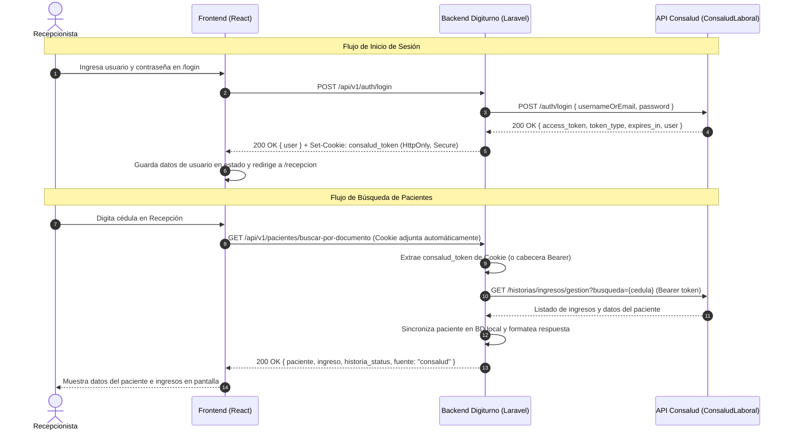

# Especificación de Diseño: Autenticación con Consalud y Búsqueda Segura de Pacientes en Recepción

**Fecha:** 2026-10-09  
**Estado:** Aprobado para Planificación  
**Módulos afectados:** `backend` (Laravel), `frontend` (React + TypeScript)

---

## 1. Contexto y Objetivos

Actualmente, Digiturno utilizaba un token estático o simulado en `localStorage` (`ips-token`) para las consultas del personal, y las llamadas a Consalud se realizaban mediante credenciales de servicio estáticas definidas en el `.env`.

Con la actualización de la URL base de Consalud a `https://api.consaludlaboral.com.co/api`, se requiere:
1. Implementar un flujo de **inicio de sesión real** conectado al endpoint `/auth/login` de Consalud.
2. Identificar al personal de **Recepción** que interactúa con el sistema (saber quién atiende y consulta).
3. Utilizar el token del recepcionista autenticado para realizar la búsqueda de pacientes por cédula y obtener sus ingresos del día.
4. Aplicar un estándar de **máxima seguridad** (protección contra XSS mediante cookies `HttpOnly`, rate limiting contra ataques de fuerza bruta, sanitización de credenciales y cierre por inactividad).
5. Excluir el Kiosco de autoservicio de este alcance (se mantiene diferido para una fase posterior).

---

## 2. Arquitectura del Sistema

Se implementa una arquitectura **BFF (Backend for Frontend)** donde el backend de Laravel de Digiturno actúa como proxy seguro entre el frontend y la API de Consalud.



---

## 3. Especificación Backend (Laravel)

### 3.1. Nuevo Módulo de Autenticación (`app/Modules/Auth/`)
* **Archivo de Rutas (`app/Modules/Auth/routes.php`):**
  * `POST /api/v1/auth/login` con middleware `throttle:5,1` (máximo 5 intentos por minuto por IP).
  * `POST /api/v1/auth/logout`: Elimina la cookie de sesión.
  * `GET /api/v1/auth/me`: Retorna los datos del usuario en sesión activa.
* **Controlador (`ControladorAuth.php`):**
  * Valida `usernameOrEmail` (requerido, string) y `password` (requerido, string).
  * Llama a `ConsaludService::login($usernameOrEmail, $password)`.
  * Valida que el usuario tenga estado activo (`estado === 1`).
  * Emite la cookie HTTP `consalud_token`:
    * `HttpOnly`: true (inmune a lectura desde JavaScript).
    * `Secure`: true (o dinámico según entorno HTTPS).
    * `SameSite`: `'Lax'`.
    * `Expires`: Tiempo en minutos coincidente con `expires_in`.
  * Retorna JSON con la información pública del usuario:
    ```json
    {
      "success": true,
      "user": {
        "id": 15,
        "usuario": "recepcion01",
        "primer_nombre": "Ana",
        "primer_apellido": "Martínez",
        "email": "ana@ejemplo.com",
        "role_id": 2
      }
    }
    ```

### 3.2. Adaptación de `ConsaludService.php`
* Método `login(string $user, string $password): array|null`:
  * Realiza petición `POST $this->baseUrl . '/auth/login'`.
  * Mapea respuestas exitosas y errores (HTTP 401, 403, 500).
* Método `buscarPacientes(string $busqueda, ?string $userToken = null): array`:
  * Si `$userToken` está presente, lo prioriza como Bearer token para la petición a `/historias/ingresos/gestion`.
  * Mantiene fallback al token de sistema si no se proporciona token de usuario.
* Método `buscarIngresoCompleto(string $documento, ?string $userToken = null): ?array`:
  * Pasa `$userToken` hacia `buscarPacientes`.

### 3.3. Adaptación de `ControladorPaciente.php`
* En `buscarPorDocumento(Request $request)`:
  * Lee el token desde `$request->cookie('consalud_token')` o `$request->bearerToken()`.
  * Invoca `ConsaludService::buscarIngresoCompleto($documento, $token)`.

---

## 4. Especificación Frontend (React + TypeScript)

### 4.1. Módulo `features/auth/`
* **Página de Login (`LoginPage.tsx` en `/login`):**
  * Formulario con inputs para `usernameOrEmail` y `password`.
  * Indicador visual de carga durante la autenticación.
  * Captura de errores con notificaciones amigables (ej. *"Credenciales incorrectas"*).
  * Redirección a `/recepcion` tras login exitoso.

### 4.2. Estado de Sesión y Control de Acceso
* **Hook / Store (`useAuth.ts`):**
  * Almacena datos del usuario activo en memoria y `localStorage` (`user_profile`).
  * Expone función `logout()` que invoca `POST /api/v1/auth/logout`, limpia el almacenamiento local y redirige a `/login`.
* **Guardián de Rutas (`RequireStaff.tsx`):**
  * Protege `/recepcion`. Si no hay usuario autenticado, redirige inmediatamente a `/login`.
* **Cierre por Inactividad:**
  * Temporizador de 15 minutos sin interacción del usuario (teclado/mouse) que ejecuta `logout()` automáticamente para proteger los datos médicos visibles en recepción.

### 4.3. Cliente HTTP (`api-client.ts`)
* Interceptor de Axios configurado con `withCredentials: true` para el envío automático de cookies en cada petición al backend.
* Manejo global de respuesta 401: limpia la sesión y redirige a `/login` con el mensaje *"Tu sesión ha caducado, por favor inicia sesión nuevamente"*.

---

## 5. Medidas de Seguridad Aplicadas

1. **Anti-XSS:** El token de autenticación nunca se almacena en `localStorage`; reside en una cookie `HttpOnly`.
2. **Anti-Fuerza Bruta:** Rate limiting de 5 intentos por minuto en el endpoint `/api/v1/auth/login`.
3. **Control de Acceso:** Verificación obligatoria de estado activo del usuario antes de otorgar la sesión.
4. **Protección de Credenciales en Logs:** Parámetro `password` excluido explícitamente de trazas de logs de Laravel.
5. **Auto-Logout:** Cierre de sesión por inactividad tras 15 minutos.

---

## 6. Plan de Verificación y Pruebas

* **Test de Login Exitoso:** Iniciar sesión con credenciales válidas en `/login`, verificar recepción de cookie `HttpOnly` y redirección a `/recepcion`.
* **Test de Credenciales Inválidas:** Probar contraseña errónea y verificar mensaje de error 401 sin revelar detalles internos.
* **Test de Rate Limiting:** Enviar más de 5 peticiones erróneas consecutivas y comprobar respuesta 429 Too Many Requests.
* **Test de Búsqueda de Paciente:** Realizar búsqueda por documento en `/recepcion` y validar que los datos e ingresos provienen de la nueva URL de Consalud con el token activo.
* **Test de Logout:** Verificar eliminación de la cookie y redirección a `/login`.
