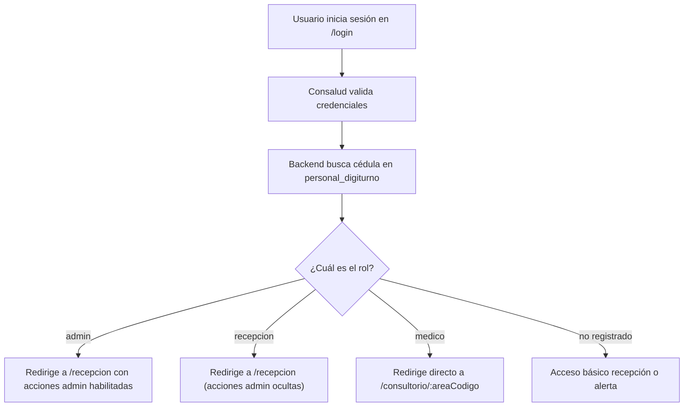

# Especificación de Diseño: Control de Acceso por Roles, Asignación de Consultorios y Gestión de Personal

**Fecha:** 2026-10-10  
**Estado:** Aprobado por el usuario  
**Módulos afectados:** `backend` (Laravel 11), `frontend` (React 19 + TypeScript)

---

## 1. Contexto y Objetivos

Actualmente, cualquier usuario que inicia sesión en Digiturno ingresa a la vista de Recepción y tiene acceso visual a las opciones administrativas (`/dashboard`, `/admin/areas`, `/admin/videos`). Además, no existe una vinculación entre los médicos y sus consultorios físicos o áreas de atención, obligando a los profesionales a navegar manualmente hasta su sala.

Con este diseño se busca:
1. **Control de Acceso Basado en Roles (RBAC):** Definir tres roles bien diferenciados: `admin`, `recepcion` y `medico`.
2. **Sembrado Inicial de Administradores:** Registrar automáticamente como administradores iniciales a las cédulas **`1065584737`** y **`1065562800`**.
3. **Flujo Especializado para Médicos:** Al iniciar sesión con sus credenciales de Consalud, el médico es redirigido inmediatamente a su consultorio asignado (ej. `/consultorio/c1`), permitiéndole rotar entre otros consultorios si es necesario.
4. **Privacidad y Blindaje Administrativo:** Ocultar las acciones administrativas a usuarios no autorizados y proteger las rutas `/admin/*` y `/dashboard` contra accesos no permitidos.
5. **Módulo de Gestión de Personal:** Proveer al Administrador una interfaz para registrar colaboradores, asignarles roles, definir su consultorio predeterminado y gestionar su estado.

---

## 2. Arquitectura General y Flujo de Sesión



---

## 3. Especificación Backend (Laravel 11)

### 3.1. Migración y Modelo: `personal_digiturno`
* **Tabla:** `personal_digiturno`
* **Columnas:**
  * `id`: BigIncrements
  * `numero_documento`: string(30) UNIQUE, INDEX (cédula del colaborador en Consalud)
  * `nombre`: string(255) NULLABLE (nombre para rápida identificación)
  * `rol`: string(20) NOT NULL ('admin', 'recepcion', 'medico')
  * `area_id_predeterminada`: unsignedBigInteger NULLABLE (FK -> `areas.id`)
  * `puede_rotar`: boolean DEFAULT true
  * `activo`: boolean DEFAULT true
  * `created_at`, `updated_at`: timestamps
* **Modelo Eloquent (`App\Models\PersonalDigiturno`):**
  * Relación `belongsTo(Area::class, 'area_id_predeterminada')`.
  * Scopes: `scopeActivo($query)`, `scopeMedicos($query)`.

### 3.2. Seeder Inicial de Administradores
* **Archivo:** `database/seeders/PersonalInicialSeeder.php`
* Registra o actualiza (`updateOrCreate`):
  * Cédula `1065584737` &rarr; Rol: `'admin'`, Nombre: `'Administrador 1'`, Activo: `true`.
  * Cédula `1065562800` &rarr; Rol: `'admin'`, Nombre: `'Administrador 2'`, Activo: `true`.
* Se invoca en `DatabaseSeeder.php`.

### 3.3. Enriquecimiento del Login (`ControladorAuth@login`)
Al autenticar contra Consalud:
1. Extrae `$usuario['identificacion']`.
2. Consulta `PersonalDigiturno::with('areaPredeterminada')->where('numero_documento', $identificacion)->where('activo', true)->first()`.
3. Si existe:
   * Asigna `rol`, `area_predeterminada` (`id`, `codigo`, `nombre`, `prefijo`), y `puede_rotar`.
4. Si no existe:
   * Asigna por defecto `rol: 'recepcion'` o restringe según configuración.
5. Devuelve la estructura consolidada en la respuesta JSON y cookie de sesión.

### 3.4. API de Gestión de Personal (Admin)
* **Controlador:** `App\Modules\Admin\Controllers\ControladorPersonal`
* **Rutas (`app/Modules/Admin/routes.php`):**
  * `GET /api/v1/admin/personal`: Listado con relaciones de área.
  * `POST /api/v1/admin/personal`: Registro de nuevo colaborador (valida cédula única, rol y área).
  * `PUT /api/v1/admin/personal/{id}`: Modificación de rol, área o estado.
  * `PATCH /api/v1/admin/personal/{id}/toggle-activo`: Activar / Desactivar.

---

## 4. Especificación Frontend (React 19 + TypeScript)

### 4.1. Tipos y Estado de Usuario (`useAuth.ts`)
* Se expande la interfaz `ConsaludUser` para incluir:
  * `rol: 'admin' | 'recepcion' | 'medico'`
  * `area_predeterminada?: { id: number; codigo: string; nombre: string; prefijo: string }`
  * `puede_rotar?: boolean`

### 4.2. Redirección Inteligente tras Login (`LoginPage.tsx`)
```ts
if (userData?.rol === 'medico' && userData?.area_predeterminada?.codigo) {
  navigate(`/consultorio/${userData.area_predeterminada.codigo}`, { replace: true });
} else {
  navigate('/recepcion', { replace: true });
}
```

### 4.3. Blindaje de Secciones y Protección de Rutas
* **Ocultamiento en Recepción (`ReceptionPage.tsx`):**
  * Los botones *"Dashboard"*, *"Admin Áreas"*, *"Admin Videos"* y el nuevo *"Gestión de Personal"* solo se renderizan si `user?.rol === 'admin'`.
* **Guardián de Rutas (`RequireRole.tsx` / `RequireAdmin.tsx`):**
  * Envuelve las rutas `/admin/*` y `/dashboard`.
  * Si el usuario logueado no tiene rol `admin`, redirige a su vista correspondiente (`/recepcion` o `/consultorio/...`) mostrando una notificación de advertencia.

### 4.4. Pantalla de Gestión de Personal (`AdminPersonalPage.tsx`)
* **Ruta:** `/admin/personal`
* **Características:**
  * Tabla con buscador por cédula o nombre.
  * Badges visuales por rol (Admin, Recepción, Médico).
  * Columna con el consultorio predeterminado y estado de rotación.
  * Switch o botón para activar/desactivar acceso.
  * **Modal "Registrar Colaborador":**
    * Cédula de Consalud (requerido).
    * Nombre (opcional).
    * Selector de Rol: Admin, Recepción, Médico.
    * Si es Médico: Selector de Consultorio Predeterminado y casilla *"Permitir rotar a otros consultorios"*.

---

## 5. Casos de Prueba y Verificación

1. **Test Login Administrador (`1065584737` o `1065562800`):**
   * Verificar que al ingresar ve todas las opciones administrativas y el acceso a Gestión de Personal.
2. **Test Login Médico:**
   * Crear un médico asociado al área `c1` (*Consultorio 1*).
   * Al iniciar sesión, verificar que es redirigido inmediatamente a `/consultorio/c1` sin pasar por recepción.
   * Probar el selector de cabecera para verificar que puede rotar si tiene el permiso activo.
3. **Test Login Recepcionista:**
   * Iniciar sesión con un usuario recepcionista.
   * Verificar que en la barra lateral NO aparecen los botones de Dashboard ni Administración.
   * Intentar ingresar manualmente a `/admin/personal` en el navegador y comprobar que el guardián de ruta lo bloquea.
4. **Test CRUD de Personal:**
   * Registrar una nueva cédula desde el panel de admin y verificar su persistencia en la base de datos.
